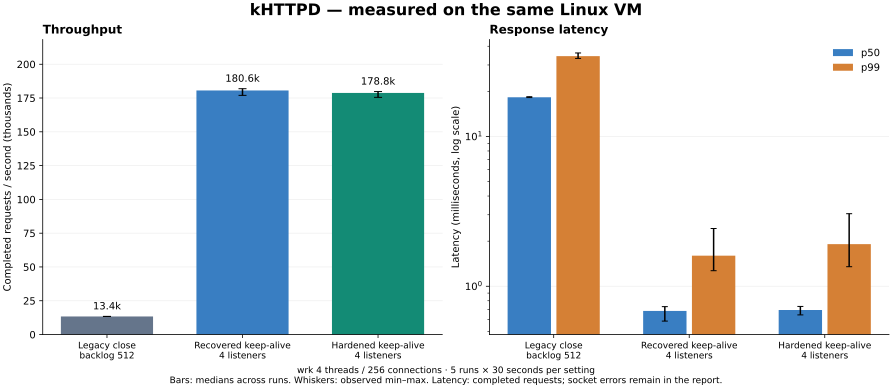

# Measured historical optimization and hardened runtime

The repaired project reproduced a **13.34× median paired throughput improvement** over the recovered close-per-request baseline in five 30-second runs on the same 4-vCPU Linux VM. The hardened result was **178,780.35 req/s**, **0.694 ms p50** and **1.910 ms p99** (medians across runs). Every paired throughput improvement was above 13×. The recovered optimized implementation achieved a similar result, showing that the historical optimization mechanism survives independently of the new parser and worker design.

The [archived 2025 logs](../artifacts/legacy-2025/README.md) record 3,436.83 → 37,739.84 req/s, p50 74.80 → 2.99 ms and p99 113.04 → 12.06 ms. The current experiment reconstructs the source behavior on recorded new hardware; the original machine and executable are unavailable. Ratios below use only paired measurements from the same experiment.

## Primary result: five repeated 30-second runs

| Configuration | req/s median [min–max] | p50 ms median [min–max] | p99 ms median [min–max] | wrk socket errors |
|---|---:|---:|---:|---:|
| Recovered close baseline, backlog 512 | 13,389.00 [13,363.29–13,454.29] | 18.260 [18.170–18.410] | 34.360 [33.160–36.080] | 0 in all 5 runs |
| Recovered optimized path, 4 listeners | 180,608.67 [176,958.28–181,909.15] | 0.684 [0.585–0.731] | 1.600 [1.270–2.430] | 0 in all 5 runs |
| Hardened implementation, 4 listeners / 512 workers | 178,780.35 [175,509.41–179,788.53] | 0.694 [0.644–0.733] | 1.910 [1.350–3.050] | 0 in all 5 runs |

The hardened median paired gain is **13.337× [13.045–13.428×]**; median paired p50 reduction is **96.21% [95.97–96.49%]**, and p99 reduction is **94.41% [90.80–96.26%]**. The recovered optimized path has a median paired gain of **13.512× [13.153–13.610×]**. Ratios pair each configuration with the baseline in the same repetition. Percentiles are computed by wrk for completed requests; the table reports medians of those per-run values, not pooled percentiles. Min–max bars are observed ranges, not confidence intervals.

**Environment and scope:** AMD EPYC 9V74 guest CPU, 4 logical vCPUs (2 cores with SMT), approximately 16 GiB RAM, Ubuntu 24.04.5, Linux 7.0.0-1017-azure x86-64, GCC 13.3.0, wrk debian/4.1.0-4build2. Both wrk and the module use the same entire VM and loopback; there is no nested QEMU CPU emulation or dedicated client core. The CPU is saturated in the optimized cells, so this measures the complete client/server workload on that VM, not an isolated server-capacity ceiling.

**Workload:** HTTP/1.1 GET /, fixed 12-byte Hello World! body, wrk 4 threads / 256 connections / 2-second timeout. Each cell gets a fresh module, a separate 2-second status/body validation phase, 5-second warmup and 30-second plain-wrk measurement. Profile order is randomized within each of five repetitions (recorded seed 20261117). Timed cells completed **2,011,901 baseline**, **27,010,334 recovered optimized**, and **26,732,678 hardened** responses. All 15 timed cells had zero wrk connect/read/write/timeout errors and no non-success statuses. Separate validation checked **3,437,770 responses, zero invalid**. Body validation runs in a separate phase; the timed phase uses plain wrk to avoid Lua callback overhead in the throughput measurement.

The conservative baseline uses backlog 512 rather than the old default 100, matching the optimized backlog. This avoids assigning a smaller accept queue's failures to the other changes. Every implementation uses the kernel TCP stack. This is a project-version comparison, not a claim that kernel HTTP is 13× faster than a matched userspace server.

## Why the gain happens

The old header macro was named as if it supported keep-alive, but actually emitted **Connection: close**. The server also created a new kthread for each accepted connection. Consequently nearly every request paid TCP connection setup/teardown and task creation costs. With correct persistence, approximately 256 connections can carry millions of requests.

The primary run's legacy counters make that difference visible: the close baseline spawned **401,478–404,515 kthreads per cell** for roughly 400,000 client-completed requests. The recovered persistent path spawned **257 per cell** for **5.32–5.47 million** client-completed requests. Buffer allocation calls are also per connection, not per request in the persistent case. System-wide context switches per completed request fell from a median **12.598** to **1.456** in the recovered path and **1.464** in the hardened path. These system counters include wrk and other VM activity; they are not server-exclusive scheduling measurements.

The hardened implementation uses 512 reusable tracked workers instead of spawning connection threads. It adds strict bounded framing, deadlines, shutdown and joins while retaining performance close to the recovered optimized version. On this primary VM its median req/s is about 1% lower than the recovered optimized path; the data does not show a further throughput win from the hardening itself. The benefit is bounded resource ownership and correct lifecycle behavior without losing the large improvement over the old path.

## Independent matched feature experiment

[Run 44003646281](https://github.com/wuwaynee/khttpd/actions/runs/44003646281) repeats ten configurations three times for 10 seconds each, with 2-second validation and warmup. This is a second, freshly allocated **4-vCPU Intel Xeon 6975P-C** VM on **Linux 7.0.0-1014-aws**. It is intentionally reported separately from the AMD primary VM. Source 9ee238ad74fb65368d876fd56228a0944c307147 changes only the ablation workflow from the primary source; the module, historical adapter and runner are identical.

Its hardened median was **384,955.94 req/s**, p50 **0.326 ms**, p99 **0.638 ms**. Relative to its own close baseline, the paired gain was **27.031× [23.257–27.805×]**. All 30 timed cells had zero wrk socket errors. Separate body validation checked **15,933,141 responses, zero invalid**. Different absolute rates between the two VMs demonstrate why the source, topology and environment belong with each result; the larger multiplier is not substituted for the primary five-run result.

Each row below changes only the stated switch within this second experiment. Ratios pair the two profiles in the same repetition. Effects are conditional on the surrounding configuration; they must not be multiplied as independent contributions.

| Isolated change | Paired req/s multiplier, median [min–max] | Interpretation |
|---|---:|---|
| Enable persistence; retain URL logging and clearing | 12.448× [11.458–12.582] | Large improvement with the other legacy settings retained. |
| Remove per-request URL logging | 1.948× [1.825–2.355] | Throughput and tail latency both improve on this host. |
| Remove per-request buffer clearing | 1.013× [0.942–1.234] | Range crosses 1; no stable isolated throughput benefit established. |
| Legacy listeners: 1 to 4 | 1.002× [0.986–1.009] | Approximately neutral for steady persistent connections. |
| Legacy mempool to kmalloc per connection | 1.009× [1.000–1.016] | Approximately neutral; no mempool throughput advantage established. |
| Hardened listeners: 1 to 4 | 0.987× [0.914–1.057] | Range crosses 1; no stable throughput advantage established. |
| Hardened preallocation to allocation per connection | 1.025× [0.991–1.168] | Range crosses 1; preallocation has no demonstrated throughput benefit here. |
| Hardened close to keep-alive, one listener | 4.585× [4.576–4.791] | Persistence also helps when kernel threads are already reusable. |

For the logging control, median p99 went **20.980 → 0.847 ms**. Logging was still enabled in the preceding persistence-only comparison. Console loglevel was 4 for every configuration, so kernel info messages did not get synchronously rendered to the console; printk ring-buffer work remained. The small number of repetitions and variable shared-host scheduling do not establish statistical significance for small differences. Sharding/mempool are implemented mechanisms, but this steady persistent workload does **not** establish a throughput benefit from them. Preallocation remains useful as an explicit resource/ownership policy; this experiment does not show reduced fragmentation or allocator latency.

## Source recovery and fixes

The complete historical optimized code survives on a feature branch at [c745737](https://github.com/wuwaynee/khttpd/tree/c745737c59476688755ca171da084a9670c5d9db). The earlier [3fbe63b](https://github.com/wuwaynee/khttpd/commit/3fbe63b16956dad8a05dfa087af932c283cfdcd0) contains the close/log/clear behavior. The later [1ca8a87](https://github.com/wuwaynee/khttpd/commit/1ca8a87e228afe0a8885880f03089fd0d42bb713) introduced three literal truncated source lines. The available chronology is consistent with a measured working tree followed by a broken upload; that is an inference, not proof of the exact old executable.

The repaired main implementation resolves the truncated source, unbounded URL accumulation, ignored parser results, zero-send loop, unbounded connection-thread creation, and unjoined-worker/module-unload risks. It also makes parameter semantics explicit: **workers=512** is connection-handling capacity; **shards=4** is listener count. The old workers=4 meant acceptors and spawned additional connection threads, so carrying that command into the new design would limit it to four concurrent clients.

The separate historical adapter retains the recovered hot path with disclosed common build/lifetime repairs. Valid close and persistent frames are checked as **112 and 117 application bytes**; both contain the same 12-byte body. See [the full reconstruction method](PERFORMANCE_METHOD.md), [design](DESIGN.md), and [correctness record](VALIDATION.md).

## Raw evidence and independent checking

| Dataset | Source / workflow | Permanent evidence |
|---|---|---|
| Primary 5 × 30 s; same-host exploratory controls also included | [c1dda1a](https://github.com/wuwaynee/khttpd/tree/c1dda1ae93c1deb3cf2cc258051a7113f13a0094), [run 44002074047](https://github.com/wuwaynee/khttpd/actions/runs/44002074047) | [raw.zip](../artifacts/performance/run_44002074047/raw.zip), [SHA-256](../artifacts/performance/run_44002074047/raw.zip.sha256), [readable summary](../artifacts/performance/run_44002074047/summary.md), [per-run JSON](../artifacts/performance/run_44002074047/summary.json) |
| Independent 10-profile matched controls, 3 × 10 s | [9ee238a](https://github.com/wuwaynee/khttpd/tree/9ee238ad74fb65368d876fd56228a0944c307147), [run 44003646281](https://github.com/wuwaynee/khttpd/actions/runs/44003646281) | [raw.zip](../artifacts/performance/run_44003646281/raw.zip), [SHA-256](../artifacts/performance/run_44003646281/raw.zip.sha256), [readable summary](../artifacts/performance/run_44003646281/summary.md), [per-run JSON](../artifacts/performance/run_44003646281/summary.json) |
| Incomplete predecessor, excluded from results | [c3dcc62](https://github.com/wuwaynee/khttpd/tree/c3dcc62427164aa72c0856c00afcaf7245aef13f), [run 44000139898](https://github.com/wuwaynee/khttpd/actions/runs/44000139898) | [raw.zip and explanation](../artifacts/performance/incomplete_run_44000139898/README.md) |

Archives contain raw stdout/stderr, every manifest/configuration/order, validation output and checksums, environment, before/after kernel counters and source/binary hashes. Both downloaded archive digests matched GitHub's artifact digests. The checked-in summaries were independently recomputed from the hash-checked raw files and matched exactly. They remain available after Actions artifact retention expires.

To re-check these published summaries from a checkout containing the evidence:

~~~bash
(cd artifacts/performance/run_44002074047 && sha256sum -c raw.zip.sha256)
(cd artifacts/performance/run_44003646281 && sha256sum -c raw.zip.sha256)
mkdir -p build/evidence-primary build/evidence-matched
unzip -q artifacts/performance/run_44002074047/raw.zip -d build/evidence-primary
unzip -q artifacts/performance/run_44003646281/raw.zip -d build/evidence-matched
python3 bench/diagnose/summarize.py build/evidence-primary/primary
python3 bench/diagnose/summarize.py build/evidence-matched/matched
cmp build/evidence-primary/primary/summary.json artifacts/performance/run_44002074047/summary.json
cmp build/evidence-matched/matched/summary.json artifacts/performance/run_44003646281/summary.json
~~~

The incomplete predecessor is retained rather than silently dropped: its old backlog-100 diagnostic configuration left idle connection workers holding module references after wrk stopped. The runner refused to force-unload. A common 10-second socket timeout now bounds those orphaned legacy workers; the five-repeat experiment was rerun in full. The incomplete run has complete=false, and the summarizer rejects it. Its partial cells never enter the final medians. The earlier pilot runs were exploratory; they are not the source of the headline results.

Server I/O counters sampled after wrk exits are kept even when nonzero. In the primary hardened cells there are 142–173 post-phase I/O events and exactly the same number of additional successful server response sends beyond client-completed responses. This is consistent with in-flight work terminated at the client stop boundary; it is not proof that a successful send was consumed by a client. wrk reports zero socket errors in the measured cells. The two accounting domains are not conflated.

## Regression verification

[Run 45571444824](https://github.com/wuwaynee/khttpd/actions/runs/45571444824), source 0bfbe252a283102e5638b9004d5ece366e40a2f9, repeated the five 30-second comparison after staging all historical acceptors before startup and tightening evidence validation. The hardened HTTP runtime source was unchanged. This separate 4-vCPU Intel Xeon 6975P-C / Linux 7.0.0-1014-aws VM recorded a median paired gain of **25.313× [24.456–27.943×]**, with baseline **14,080.95 req/s** and hardened **356,433.84 req/s**. All 15 primary cells had zero wrk socket errors. This verification does not replace the AMD primary result above.

The same run completed its eight exploratory 3 × 10-second controls. The backlog-100 close_no_logging diagnostic retained 4–19 socket-error events per run; its completed-request latency is reported alongside those failures. Those diagnostic cells are excluded from the primary comparison and are not compared with 30-second cells as isolated feature effects.

[Raw archive](../artifacts/performance/run_45571444824/raw.zip), [SHA-256](../artifacts/performance/run_45571444824/raw.zip.sha256), [primary summary](../artifacts/performance/run_45571444824/summary.md) and [per-run JSON](../artifacts/performance/run_45571444824/summary.json) preserve the follow-up measurement. The downloaded digest matched GitHub's artifact digest; both its primary and exploratory summaries recomputed exactly from the raw logs.

## Reproduction

Use the [native reproduction commands](PERFORMANCE_METHOD.md#run-the-reproduction) in a disposable Linux VM with matching headers and module-loading privileges, or run the [performance workflow](../.github/workflows/performance.yml). The method pins a reviewed revision with the subsequent startup/evidence guards; every new execution records its own source identity. Original measured revisions remain identified in the archive table and can be fetched explicitly by SHA. The [ablation workflow](../.github/workflows/ablation.yml) defines the matched feature controls. The harness rejects dirty source, missing cells, invalid bodies/statuses and checksum mismatches.

This result establishes a reproducible improvement for a fixed-body kernel microserver workload. It does not establish a universal 11× multiplier, identical absolute results on arbitrary hardware, production HTTP/TLS/file-serving performance, or a kernel-versus-userspace advantage. A separate constant-arrival-rate experiment is needed for independent-arrival latency/SLO claims; closed-loop wrk percentiles do not provide that by themselves.
